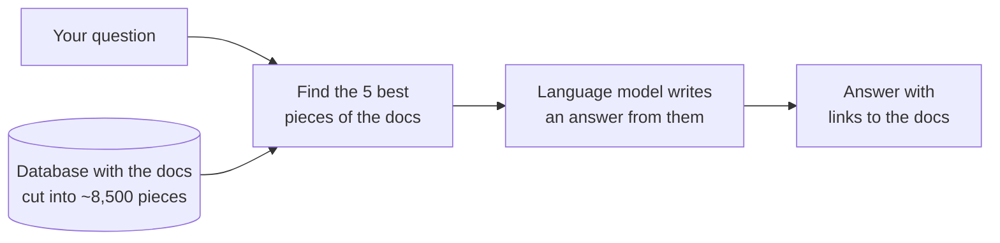
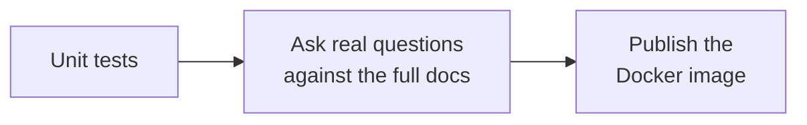

# opsrag

Ask a question about Kubernetes, Prometheus or Helm and get an answer written only from their
official documentation, with links to the pages it used. Everything runs on your own computer.

## Try it

You need [Docker](https://docs.docker.com/get-docker/). On a Mac also install
[Ollama](https://ollama.com/download) (`brew install ollama && ollama serve`),
because Docker on macOS can't use the GPU.

```bash
git clone https://github.com/JakubBialoskorski/opsrag.git
cd opsrag
./start.sh --quick
```

Open the address it prints, e.g. http://localhost:8000.

- `--quick` loads only the Helm and Prometheus docs, so it is ready in a few minutes.
  Run `./start.sh` without it to add the Kubernetes docs (the big part).
- `./stop.sh` stops everything and keeps the data. `./stop.sh --purge` deletes the data too.

## How it works

The idea is called RAG (Retrieval-Augmented Generation): first *find* the right pieces of the
docs, then let a small language model *write* an answer from just those pieces.



Before the first question, `start.sh` downloads the docs, cuts every page into short pieces
(*chunks*) and stores them in a database. The search then finds pieces in two ways at once: by
the same words, and by similar meaning. Three small models do the work:

| Model | Size | Job |
|---|---|---|
| `nomic-embed-text` | 270 MB | Turns text into a list of numbers so that texts with a similar meaning get similar numbers. This is how "pods down during maintenance" finds the page about PodDisruptionBudgets with no words in common. |
| MiniLM reranker | 23 MB | Reads the question together with the best 60 pieces and puts them in a better order. |
| `qwen3:4b-instruct` | 2.5 GB | Writes the answer. It knows nothing about these docs, so it only gets the 5 best pieces and must cite them or say it couldn't find the answer. |

So the search is responsible for *knowing* and the language model only for *writing*. When an
answer is wrong, check the search first: `docker compose exec app opsrag search "your question"`
shows the pieces the model got.

## Adding your own docs

Any git repository with Markdown files works. Add it to `sources.yaml`, then run `make update`:

```yaml
  - name: runbooks
    repo: https://github.com/acme/runbooks
    track: main
    root: docs
    url: https://github.com/acme/runbooks/blob/main/docs/{path}.md
```

## How quality is checked

`eval/questions.yaml` has 42 questions with the pages that answer them, plus 3 questions it must
refuse ("pancakes"). How often a right page is among the 5 pieces the model gets (*hit@5*):

| Search | hit@5 |
|---|---|
| by meaning only | 0.90 |
| by words only | 0.86 |
| both combined | 0.93 |
| both + reranker | **0.98** |

Every change goes through these checks on GitHub before a new image is published:



Every wrong answer that gets fixed becomes a new test question, so it can't come back. Every
Friday two workflows look for newer docs and models, run the same checks on them and open a pull
request when they find some. It merges itself once approved, and only if every check passed.

